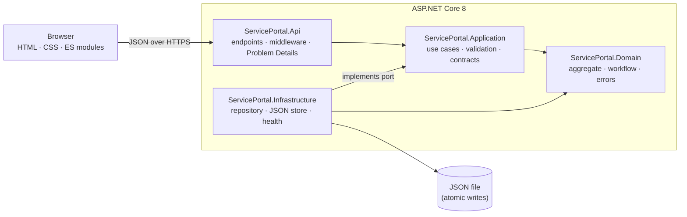

# Client Service Desk

A full-stack service-request portal for a financial document-signing platform, built to show production-grade **C# / .NET 8**, **REST API design**, and **accessibility engineering to WCAG 2.2 AA and Section 508**.

Clients submit requests; support staff search, sort, triage and resolve them. Every interaction works by keyboard alone, with screen readers, at 400% zoom and in high-contrast modes, and every state change is announced.

| | |
|---|---|
| **Backend** | ASP.NET Core 8 minimal APIs · layered architecture (Domain / Application / Infrastructure / API) · zero third-party runtime dependencies |
| **API** | Versioned REST (`/api/v1`) · RFC 9457 Problem Details · ETag / `If-Match` optimistic concurrency · rate limiting · health probes |
| **Front end** | Semantic HTML · modern CSS (cascade layers, dark mode, forced colours) · framework-free ES modules · strict CSP (no inline code) |
| **Accessibility** | WCAG 2.2 AA conformance report · axe-core clean in light and dark themes · keyboard, focus and live-region behaviour covered by tests |
| **Quality** | 98 automated tests across four suites + Playwright/axe browser suite · analyzers with warnings-as-errors · GitHub Actions CI · non-root container |

---

## Quick start

Requires the [.NET 8 SDK](https://dotnet.microsoft.com/download/dotnet/8.0).

```bash
dotnet run --project src/ServicePortal.Api
```

Open **http://localhost:5080**. Twelve realistic sample requests are created on first run and saved to `src/ServicePortal.Api/App_Data/`, so your changes survive restarts.

```bash
dotnet test                      # unit + integration tests
cd tests/e2e && npm install && npx playwright install && npm test   # browser accessibility suite
docker build -t service-portal . && docker run -p 8080:8080 -v portal-data:/data service-portal
```

---

## What to look at

**If you have five minutes:**

1. **Open the app and use only the keyboard.** Tab to the skip link, submit the empty form (focus lands on an error summary that links to each field), open a request, change its status, press Escape (focus returns to the row you came from).
2. **[`ServiceRequest.cs`](src/ServicePortal.Domain/ServiceRequests/ServiceRequest.cs)** shows a rich domain model: the status workflow is enforced in one place, and there are no public setters.
3. **[`ServiceRequestEndpoints.cs`](src/ServicePortal.Api/Endpoints/ServiceRequestEndpoints.cs)** shows thin endpoints, correct status codes, ETags and `If-Match`.
4. **[`request-form.js`](src/ServicePortal.Api/wwwroot/js/features/request-form.js)** shows the accessible validation pattern end to end.
5. **[`docs/ACCESSIBILITY.md`](docs/ACCESSIBILITY.md)** is the criterion-by-criterion conformance report.

### Engineering highlights

- **Expected failures are values, not exceptions.** Use cases return `Result<T>`; a single mapper turns each error type into the right HTTP status (400 / 404 / 409 / 412 / 428), with a stable machine-readable `code`.
- **Lost-update protection.** Every resource carries a version, exposed as an ETag. `PATCH` and `DELETE` require `If-Match` and return `412` when someone else changed the request first; the UI then reloads it and explains what happened.
- **One source of truth for rules.** Limits, categories and status labels live in the domain and are published at `GET /api/v1/metadata`; the UI builds its selects, radios and character counter from them.
- **Friendly validation by design.** Request contracts accept strings, so a bad value such as `"priority": "Urgent!!"` becomes the field message *"Choose Low, Medium or High."* rather than a serializer error. Each field returns one message, keyed to match the form's input ids.
- **Swappable persistence.** The application depends on `IServiceRequestRepository`. The shipped adapter stores immutable snapshots with atomic file writes; a database adapter would drop in without touching business code ([ADR 0003](docs/adr/0003-persistence.md)).
- **Operability.** Liveness and readiness probes (Kubernetes-ready), structured JSON logs via source-generated `LoggerMessage`, correlation ids echoed in responses and included in every error, fail-fast options validation, per-client rate limiting with `Retry-After`.
- **Security headers.** A strict Content-Security-Policy with no inline scripts or styles (enforced by a test), `nosniff`, frame denial, and HSTS in production.

### Accessibility highlights

| Pattern | Implementation |
|---|---|
| Error handling | Error summary takes focus; links move focus to each field; inline messages with `aria-invalid` + `aria-describedby`; page title prefixed with "Error:" |
| Status messages | Polite and assertive live regions present from page load; result counts, sorting, saves and deletions are announced without moving focus |
| Focus management | Explicit rules for every action, documented and tested: dialogs open on their title, return focus to the trigger (or its re-rendered equivalent), never drop focus to `<body>` |
| Data table | `caption`, `th scope`, row headers, sort buttons inside headers with `aria-sort`, scrollable region that is labelled and keyboard-focusable |
| Colour independence | Status = shape + colour + word; priority = bars + word; links underlined; errors carry an icon and text |
| Preferences | Light/dark themes both verified ≥ 4.5:1 (lowest pair 5.6:1), reduced motion, Windows High Contrast, print stylesheet |

---

## Architecture



Dependencies point inward: the domain references nothing, and the application defines the persistence interface that infrastructure implements. See [docs/ARCHITECTURE.md](docs/ARCHITECTURE.md) for the request lifecycle, concurrency flow and front-end module map.

## Repository layout

```
src/
  ServicePortal.Domain/           Aggregate, workflow rules, Result/Error types
  ServicePortal.Application/      Use cases, validation, contracts, repository port
  ServicePortal.Infrastructure/   Snapshot repository, JSON file store, seeding, health check
  ServicePortal.Api/              Endpoints, middleware, configuration, wwwroot (front end)
tests/
  ServicePortal.Domain.Tests/          Workflow and invariants
  ServicePortal.Application.Tests/     Validation and use cases against a fake repository
  ServicePortal.Infrastructure.Tests/  Persistence, atomic writes, concurrency, paging
  ServicePortal.Api.IntegrationTests/  HTTP contract, platform behaviour, accessibility markup
  e2e/                                 Playwright + axe-core: keyboard journeys, reflow, scans
docs/
  ARCHITECTURE.md · ACCESSIBILITY.md · API.md · adr/
```

## API at a glance

| Method | Route | Success | Notable errors |
|---|---|---|---|
| `GET` | `/api/v1/service-requests?status=&search=&sort=-priority&page=&pageSize=` | 200 page | 400 |
| `GET` | `/api/v1/service-requests/{id}` | 200 + `ETag` (304 with `If-None-Match`) | 404 |
| `POST` | `/api/v1/service-requests` | 201 + `Location` + `ETag` | 400, 429 |
| `PATCH` | `/api/v1/service-requests/{id}/status` (`If-Match` required) | 200 + new `ETag` | 400, 404, 409, 412, 428 |
| `DELETE` | `/api/v1/service-requests/{id}` (`If-Match` required) | 204 | 404, 412, 428 |
| `GET` | `/api/v1/service-requests/summary` | 200 | — |
| `GET` | `/api/v1/metadata` | 200 | — |
| `GET` | `/health/live`, `/health/ready` | 200 | 503 |

Full reference with examples: [docs/API.md](docs/API.md).

## Configuration

| Setting | Default | Purpose |
|---|---|---|
| `Storage:Provider` | `File` | `File` (persisted) or `InMemory` (used by tests) |
| `Storage:FilePath` | `App_Data/service-requests.json` | Relative to the content root, or absolute |
| `Storage:SeedSampleData` | `true` | Seed sample requests when the store is empty |
| `RateLimiting:SubmissionPermitLimit` | `10` | New submissions per client per window |
| `RateLimiting:SubmissionWindowSeconds` | `60` | Rate-limit window |

Every setting can be overridden with environment variables, for example `Storage__Provider=InMemory`. Invalid values stop the app at startup rather than failing later.

## Design decisions

- [ADR 0001 – Layered architecture with a rich domain model](docs/adr/0001-layered-architecture.md)
- [ADR 0002 – Result pattern and Problem Details for errors](docs/adr/0002-errors-as-values.md)
- [ADR 0003 – Snapshot persistence behind a repository port](docs/adr/0003-persistence.md)
- [ADR 0004 – Framework-free front end](docs/adr/0004-framework-free-front-end.md)
