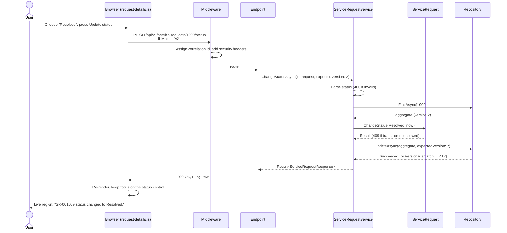
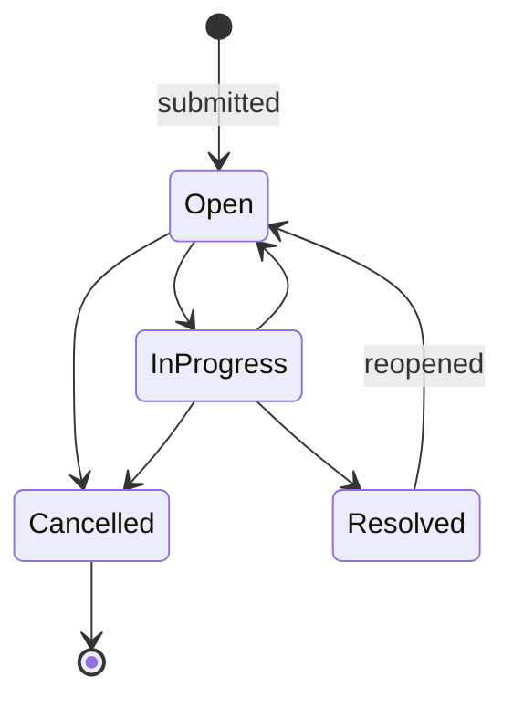

# Architecture

## Goals

1. Business rules live in one place and can be tested without a web server or a database.
2. The HTTP contract is predictable: correct status codes, one error format, stable error codes.
3. Concurrent edits never silently overwrite each other.
4. Accessibility is a property of the architecture (server-published rules, deliberate focus and announcement handling), not a final polish pass.

## Layers

| Project | Responsibility | Depends on |
|---|---|---|
| `ServicePortal.Domain` | `ServiceRequest` aggregate, status workflow, `Result`/`Error`, input limits | nothing |
| `ServicePortal.Application` | Use cases (`ServiceRequestService`), validation, query parsing, request/response contracts, `IServiceRequestRepository` port | Domain |
| `ServicePortal.Infrastructure` | Repository adapter, JSON snapshot store, sample data, storage health check | Application, Domain |
| `ServicePortal.Api` | Endpoints, middleware, Problem Details mapping, ETags, rate limiting, static front end | Application, Infrastructure |

The composition root is `Program.cs`, which calls `AddApplication()`, `AddInfrastructure()` and `AddApi()`.

## Request lifecycle: changing a status



## Status workflow



The transition table lives in `ServiceRequest`. Each response includes `allowedTransitions`, so the UI offers only valid next steps.

## Error model

| Domain `ErrorType` | HTTP | Example `code` |
|---|---|---|
| `Validation` | 400 | `validation_failed` (with per-field `errors`) |
| `NotFound` | 404 | `service_request.not_found` |
| `Conflict` | 409 | `service_request.invalid_status_transition` |
| `PreconditionFailed` | 412 | `service_request.concurrency_conflict` |
| `PreconditionRequired` | 428 | `service_request.version_required` |
| *(malformed body)* | 400 | `request.malformed` |
| *(rate limited)* | 429 | `rate_limited` |
| *(unexpected exception)* | 500 | `server.unexpected` (no internals leaked) |

Every Problem Details body also carries `traceId` and `correlationId`, so a user-reported failure can be found in the logs.

## Persistence

`ServiceRequestRepository` keeps an in-memory index of immutable snapshots and serialises writes through a single async gate. The `ISnapshotStore` it uses is either:

- `InMemorySnapshotStore`, used in tests, or
- `JsonFileSnapshotStore`, which writes to a temp file and atomically replaces the data file. A corrupt file stops the app loudly instead of being overwritten.

This suits a single instance. Scaling out means swapping in a database adapter that uses row versions for the same concurrency semantics. See [ADR 0003](adr/0003-persistence.md).

## Front end

```
wwwroot/js/
  main.js                      composition root: loads metadata, wires features via callbacks
  core/
    api-client.js              fetch + timeouts + cancellation, Problem Details → ApiError, ETags
    announcer.js               polite / assertive live regions
    dialog.js                  native <dialog> with focus return
    dom.js                     h() element builder (text nodes only, XSS-safe), helpers
    format.js                  dates, status/priority marks, server-sourced labels
  features/
    request-list.js            search, filter, sort, pagination, URL state, race-free loading
    status-ledger.js           status bar + filter buttons (aria-pressed)
    request-details.js         details dialog, status change, delete, 412 recovery
    request-form.js            accessible validation, error summary, character count
    disclosure.js              show/hide pattern
```

Features never import each other; `main.js` connects them with callbacks. No build step is required, and the Content-Security-Policy allows only same-origin scripts and styles.

## Operations

| Concern | Implementation |
|---|---|
| Health | `/health/live` (process up) and `/health/ready` (storage readable) |
| Logging | JSON console in Production; source-generated `LoggerMessage`; correlation id in every scope |
| Configuration | Options bound and validated at startup (`ValidateOnStart`) |
| Security | CSP, `nosniff`, `X-Frame-Options: DENY`, `Referrer-Policy`, `Permissions-Policy`, HSTS in Production |
| Container | Multi-stage build, chiseled runtime image, non-root user, data on a volume |
